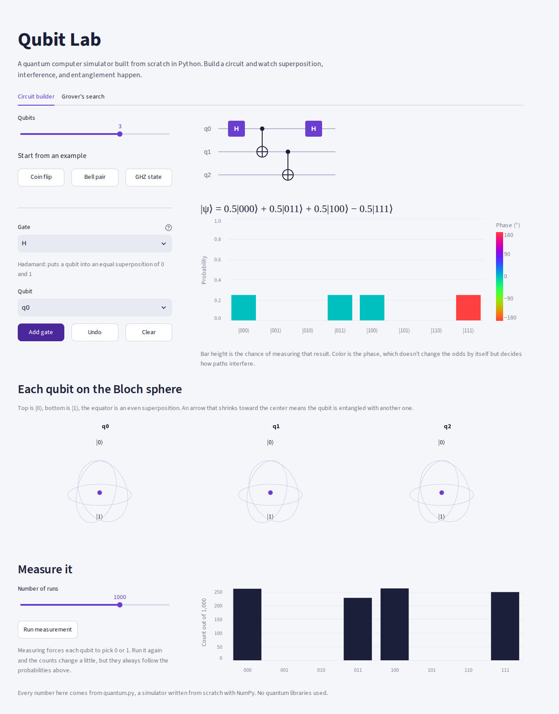
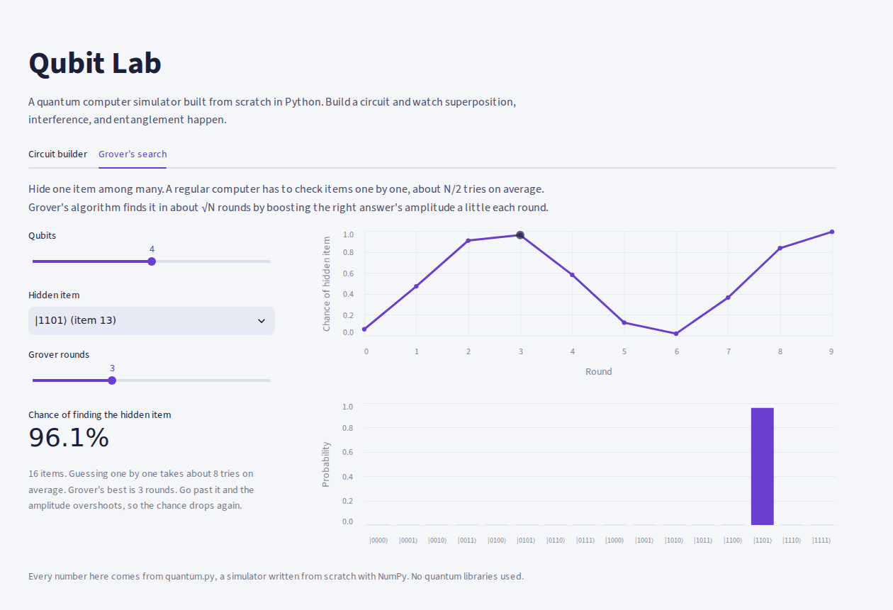

# Qubit Lab

An interactive quantum computing playground, powered by a quantum simulator written from scratch in Python with NumPy. No quantum libraries.

Build circuits and watch superposition, interference, and entanglement happen, then see Grover's algorithm find a hidden item faster than any regular search.



**Live demo:** _add your Streamlit Community Cloud link here_

## Features

**Circuit builder**
- Up to 4 qubits and 12 gates: H, X, Y, Z, S, T, RX, RY, RZ, CNOT, CZ, and SWAP
- A circuit diagram that updates as you add gates
- The full quantum state written in Dirac notation, like `0.707|00⟩ + 0.707|11⟩`
- Probability bars colored by phase, so you can see interference before you measure
- A 3D Bloch sphere for each qubit. Entangled qubits shrink to the center, because they have no state of their own.
- Simulated measurement with 10 to 10,000 runs
- One-click examples: a coin flip, a Bell pair, and a 3-qubit GHZ state

**Grover's search**
- Hide one item among up to 64
- Watch the chance of finding it rise with each round, peak, and then overshoot



## Run it

```bash
pip install -r requirements.txt
streamlit run app.py
```

## How it works

### The simulator (`quantum.py`)

- **State:** n qubits are stored as 2ⁿ complex numbers called amplitudes. The chance of measuring a result is its amplitude's size squared.
- **Gates:** each single-qubit gate is a 2×2 matrix. To apply one, the state is reshaped into an n-dimensional grid (2 × 2 × … × 2) where each axis is one qubit, then multiplied along just that qubit's axis with `np.tensordot`. That avoids building giant 2ⁿ × 2ⁿ matrices.
- **Controlled gates:** CNOT and CZ apply their matrix only to the slice of the grid where the control qubit is 1. SWAP is built from three CNOTs.
- **Bloch vectors:** computed from each qubit's reduced density matrix, which is what makes an entangled qubit's arrow shrink.
- **Measurement:** samples outcomes with `numpy.random` according to the probabilities.

### Grover's algorithm

Start with every item equally likely. Then repeat two steps:

1. **Oracle:** flip the sign of the hidden item's amplitude.
2. **Diffusion:** reflect every amplitude around the average.

The hidden item grows a little each round. After about (π/4)·√N rounds it's found with high probability. For 64 items, that's 6 rounds versus about 32 guesses on average for one-by-one checking.

## Tests

```bash
pip install pytest
pytest
```

18 tests check that the simulator follows real quantum mechanics: H twice cancels out (interference), Bell and GHZ states have the right amplitudes, probabilities always add to 1, entangled qubits' Bloch vectors are zero, measurements match probabilities, and Grover finds the hidden item for 2 to 6 qubits.

## Notes

Qubit 0 is the leftmost bit in a label like `|10⟩`. Some libraries, such as Qiskit, use the opposite order.

Built with help from Claude (Anthropic).
